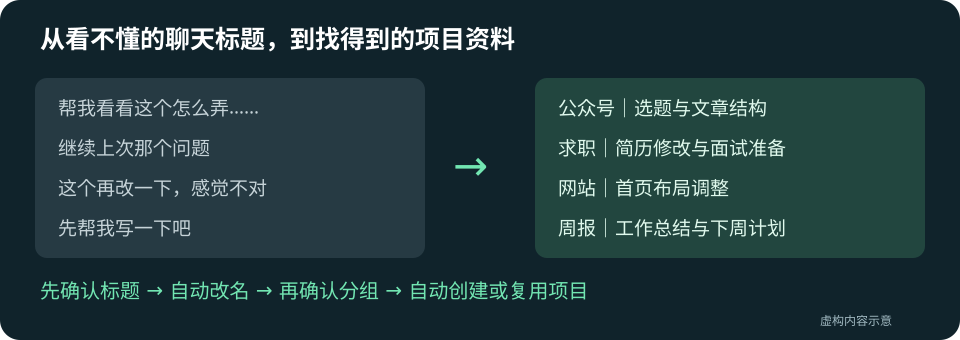

# Codex 聊天整理助手

**聊天越来越多，标题却看不懂？把链接发给 Codex，让它帮你整理。**

读取聊天内容，给出清楚、统一的标题和项目建议。你确认标题后，它负责改名；你确认分组后，它负责创建或复用项目，再把聊天归进去。



## 把这句话发给 Codex，完成安装

```text
帮我安装这个聊天整理 Skill，按仓库 AGENTS.md 完成安装和自检；已有版本就保留数据升级：
https://github.com/Tingren136/codex-chat-organizer
```

适用环境：**Windows 上的 Codex 桌面软件、Python 3.14、已登录的 Codex CLI**。整理在 Codex 桌面对话里执行。安装器不要求 Git，不改全局配置。

## 装好以后，直接这样说

| 你想做什么 | 发给 Codex 的话 |
| --- | --- |
| 先看看范围 | 用 chat-organizer 盘点一下乱标题，先不要调用模型分析。 |
| 找最近20条乱标题 | 找最近20条需要改名的聊天，先给我看方案，确认后再改。 |
| 全部检查 | 检查全部可读取聊天，跳过已处理的，先给我看标题方案。 |
| 看上次结果 | 给我看上次整理报告，不要重新分析。 |

**“20条”指20条需要改名的建议，不是随便读取20条。** 清楚的标题不占名额；超长聊天登记待处理后继续检查后面的。数量不足时说明实际数量和停止原因。

## 两次确认，完成整理

1. **看标题方案**：逐条展示原标题、建议标题、摘要和理由。可修改、保留或部分批准。
2. **确认后改名**：固定采用“对象｜具体用途”等命名规则，后续批次沿用。
3. **看项目方案**：放入已有项目、新建项目，或保留为杂聊。
4. **确认后归类**：程序创建或复用项目、准备本地目录、移动聊天并回读结果，不需要自己点菜单新建。

已处理聊天默认跳过，旧分析尽量复用；回看报告、执行确认后的方案不重复调用分析模型。通过本地程序与原生工具执行，不接管鼠标键盘。

## 自己安装或升级

下载 [最新发布版 ZIP](https://github.com/Tingren136/codex-chat-organizer/releases/latest)，解压后在该目录运行：

```powershell
powershell -NoProfile -ExecutionPolicy Bypass -File .\install.ps1 -SourcePath .
```

也可只下载根目录的 install.ps1 后运行，默认安装 v0.4.1；用 `-Version v0.4.1` 指定版本。缺 Python 时会给出下载入口。

升级使用相同命令，旧代码备份到 `CODEX_HOME/skill-backups`，缓存和命名规则保持原位。见 [安装与自检](docs/installation.md)。

## 数据与文档

默认数据位于 `CODEX_HOME/chat-organizer-data`，报告在其中的 reports。环境变量优先于私有配置，未配置时才用默认位置。升级请保留原数据目录，避免丢失处理记录。

模型通过当前登录的 Codex 分析选中聊天，会使用模型额度；本地快照和报告包含聊天信息，请保存在自己的电脑上。

- [配置与数据](docs/configuration.md)
- [命名规则与确认](skills/chat-organizer/references/naming-and-review.md)
- [项目创建与桌面登记恢复](docs/projects-and-recovery.md)
- [版本更新](CHANGELOG.md) · [验证记录](docs/validation.md)
- [隐私与反馈](SECURITY.md) · [开发发布检查](docs/releasing.md)

社区工具，非 OpenAI 官方产品。采用 [MIT 许可证](LICENSE)。
