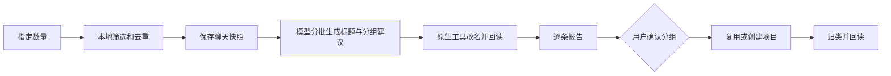

# Codex 聊天整理助手
Skill + 本地 Python 程序：按需整理聊天，自动改名，逐条给出项目建议，确认后创建项目并归类。

> v0.2.0 · Windows Codex Desktop 实验性工具。已在作者本机验证完整流程，尚未在其他电脑验证。不是 OpenAI 官方产品。

## 使用方式
安装后，在 Codex 桌面对话中说：
> 用 chat-organizer 整理20条未处理聊天，改名后逐条报告项目建议，等我确认再归类。

程序过滤已处理、当前及活动聊天；保存本地快照与分析结果；分小批生成标题和建议；通过桌面原生工具改名。你可以修改建议，确认后才执行归类。重复查看报告不会重新分析。

## 安装
需要 Windows、Python 3.14（已测试版本）、已登录的 Codex CLI，以及 Codex 桌面提供的原生工具连接环境。Python 程序仅使用标准库，不包含客户端或官方插件副本。
1. 把本仓库的整个 `skills/chat-organizer` 复制到当前 `CODEX_HOME/skills/chat-organizer`。已有版本先备份。
2. 首次使用前，设置独立数据目录和报告目录，示例见 [配置说明](docs/configuration.md)。升级只替换 Skill，不删除数据目录。
3. 在 Codex 桌面会话内运行 `py -3.14 <Skill目录>/scripts/organize.py doctor`，检查 CLI、原版工具和连接环境。
4. 让 Codex 使用 Skill。当前不承诺资源管理器双击、独立终端或计划任务可直接执行全部流程。

默认数据位于 `CODEX_HOME/chat-organizer-data`，默认报告位于该目录的 reports。请按个人目录规范覆盖报告位置。

## 它实际做了什么

本地程序负责读取、去重、意图记录和执行；模型负责理解选中聊天。选中聊天可见正文会被保存，并通过当前登录的 Codex 模型分析。因此它不是完全离线，也不保证零额外用量。标题与分组建议同批生成，已处理记录默认锁定，不随新消息自动重分析。

## 实测与边界
本机一批20条：17条改名、3条保留原标题，批准的20条项目归属最终全部回读通过；新建3个项目。命名阶段用了11个分析批次，不能说“20条只调用一次模型”。归类与修复阶段新增分析调用为0。
已处理记录累计29条。最终7条归类期间，另22条记录的标题、项目、目录与置顶状态保持不变。这些数字是一次真实验收记录，不是性能保证。

后端项目创建不等于桌面已经登记。本机版本曾需要一次受控退出，补登记后再用原生工具移动。修复路径仅支持已验证的桌面版本，详情见 [兼容与恢复](docs/projects-and-recovery.md)。验收依据是工具回执、原生目录及状态回读，未做截图验收。

## 开发与分享
- [配置与数据](docs/configuration.md)
- [项目接口与恢复](docs/projects-and-recovery.md)
- [验证记录](docs/validation.md)
- [发布检查](docs/releasing.md)
- [隐私与问题反馈](SECURITY.md)

测试：在仓库根目录运行 `py -3.14 -m unittest discover -s tests -v` 前，把 `skills/chat-organizer/scripts/runtime` 加入 PYTHONPATH。测试使用模拟数据，不需要登录，不调用模型，不操作真实聊天。

许可证采用 MIT。名称、界面和官方组件的权利属于各自权利人。

